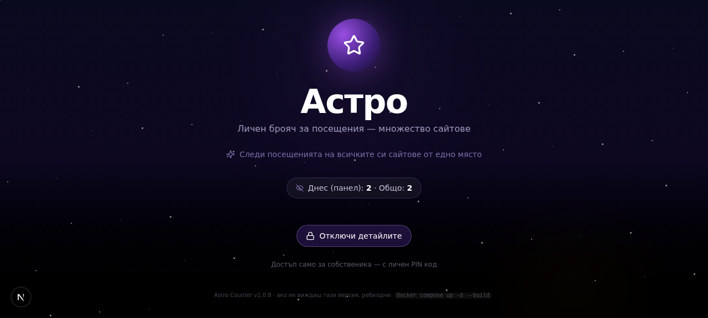
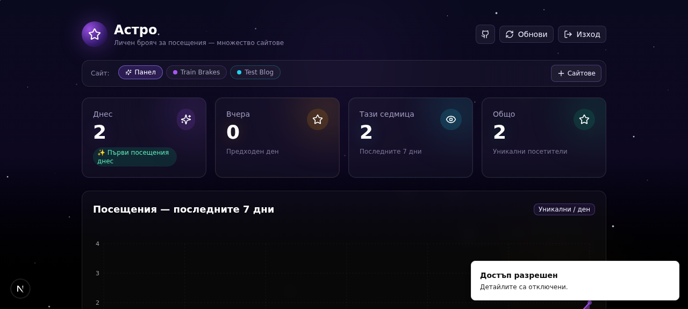

# Астро — Личен брояч за посещения

Личен брояч за посещения с поддръжка на **множество сайтове**. Вгради малък JS snippet във всеки свой сайт и виж статистики (Днес, Вчера, седмица, графики, топ държави и реферали) в един частен dashboard, защитен с PIN.

## 📸 Преглед

### Заключен екран (публичен изглед)


### Dashboard с оцветени табове за всеки сайт


### Site manager — регистрирай сайтове, избери цвят, копирай snippet



---

## ✨ Възможности

- 🔒 **PIN-защитен dashboard** — само ти виждаш статистиките (HttpOnly cookie + 7-дневна сесия)
- 🌐 **Множество сайтове** — регистрирай неограничен брой сайтове, за всеки отделна статистика
- 🎨 **Цветове за всеки сайт** — 12-цветна палитра + custom цветове, за да различаваш табовете лесно
- 📊 **Богата статистика** — Днес, Вчера, Седмица, Общо + 7-дневна area-chart + топ 10 държави + топ 10 реферали
- 🎯 **Уникални посетители/ден** — дедупликирани по IP + User-Agent + Country хеш
- 📋 **Copy-paste snippet** — за всеки сайт се генерира JS snippet с `mode: "no-cors"`, работи на всяка платформа
- 🔄 **Ротиране на API ключове** — ако ключ утече, с един клик го смениш
- 📈 **Умни trend labels** — "✨ Първи посещения", "≈ Също като вчера", "▼ N% спря вчера (беше X)" — без объркващи проценти
- 🌌 **Космическа тема** — лилаво-черно background с мигащи звезди + лилава звезда favicon
- 🐳 **Docker-ready** — multi-stage build, non-root user, persistent volume

---

## 🚀 Бърз старт

### Изисквания

- Docker 20+ и Docker Compose v2
- Порт 3000 свободен (или промени в `docker-compose.yml`)

### Стъпка 1 — Клонирай репото

```bash
git clone git@github.com:fedya-dev/astro-counter.git
cd astro-counter
```

> Ако нямаш SSH ключове, ползвай HTTPS:
> ```bash
> git clone https://github.com/fedya-dev/astro-counter.git
> cd astro-counter
> ```

### Стъпка 2 — Смени PIN-а! (ВАЖНО)

Не го оставяй `1234` — всеки, който знае това число, ще може да види статистиките ти.

```bash
nano docker-compose.yml
```

Намери реда и го смени:
```yaml
ADMIN_PIN: "1234"      # ← смени това
# на:
ADMIN_PIN: "твоя-таен-PIN-тук"
```

### Стъпка 3 — Билдни и пусни

```bash
docker compose up -d --build
```

### Стъпка 4 — Провери че тръгна

```bash
docker compose logs -f astro
# Ctrl+C за изход от лога
```

### Стъпка 5 — Отвори в браузъра

```
http://ТВОЯ-СЪРВЪР-IP:3000
```

- Кликни **"Отключи детайлите"**
- Въведи PIN-а
- Виждаш dashboard-а

### Стъпка 6 — Провери версията

```bash
curl http://ТВОЯ-СЪРВЪР-IP:3000/api/version
# Трябва да върне: {"ok":true,"version":"v1.0.8",...}
```

---

## ⚙️ Конфигурация (environment variables)

| Променлива | Задължителна | Default | Описание |
|-----------|--------------|---------|----------|
| `ADMIN_PIN` | **ДА** ✓ | `1234` | PIN за отключване. **Смени го!** |
| `DATABASE_URL` | Не | `file:/app/data/custom.db` | Път до SQLite файла |
| `TZ` | Не | `Europe/Sofia` | Timezone за дневни граници |
| `NEXT_PUBLIC_BASE_URL` | Не | (auto-detected) | Публичен URL за snippet-а |

---

## 🌐 Добавяне на сайт

1. Отвори dashboard-а → отключи с PIN
2. Кликни **"Сайтове"** (горе-дясно)
3. Във формата:
   - **Име на сайта** (напр. "Train Brakes")
   - **Домейн** (напр. "trainbrakes.com")
   - **Цвят** — кликни върху кръгче от палитрата (или ползвай custom цвете с "+" бутона)
4. Клик **"Добави сайт"**
5. В списъка със сайтове кликни **"Код"** до него
6. Кликни **"Копирай"** — snippet-ът е в клипборда
7. Постави snippet-а в HTML-а на сайта си, **точно преди `</body>`**

### За различни платформи:

| Платформа | Къде да сложиш snippet-а |
|-----------|--------------------------|
| **Astro** | `src/layouts/Layout.astro` преди `</body>` — **ползвай `<script is:inline>`** (виж долу) |
| **WordPress** | Appearance → Theme Editor → `footer.php` преди `</body>` (или плъгин "Insert Headers and Footers") |
| **Чист HTML** | Във всеки `.html` файл, преди `</body>` |
| **Next.js** | В root layout `app/layout.tsx` или `pages/_app.tsx` |
| **Shopify** | Online Store → Themes → Edit code → `theme.liquid` преди `</body>` |
| **Wix** | Settings → Custom Code → + New Custom Code → "Body - end" |

### ⚠️ Специално за Astro (важно!)

Astro по подразбиране processing-ва `<script>` таговете — bundl-ва ги, минифицира ги, понякога ги премахва. Това ще счупи tracking snippet-а.

Затова **винаги** добавяй `is:inline` директива:

```astro
---
// твоят frontmatter
---

<!DOCTYPE html>
<html lang="bg">
  <head>...</head>
  <body>
    <slot />
    
    <!-- ВАЖНО: is:inline казва на Astro да НЕ пипа този script -->
    <script is:inline>
      // ...кодът от dashboard-а тук...
    </script>
  </body>
</html>
```

Без `is:inline` — snippet-ът **няма** да работи след билд.

---

## 🔄 Миграция от GoatCounter

Ако вече ползваш GoatCounter и искаш да го замениш с Астро:

### Стъпка 1 — Намери стария GoatCounter код

GoatCounter snippet-ът обикновено изглежда така:

```html
<script data-goatcounter="https://твоето-име.goatcounter.com/count"
        async src="//gc.zgo.at/count.js"></script>
```

...или сnoscript:

```html
<noscript>
  
</noscript>
```

**Как да го намериш:**

| Платформа | Как да намериш |
|-----------|---------------|
| **Astro** | `grep -ri "goatcounter\|zgo.at" src/ public/` в проектната директория |
| **WordPress** | Appearance → Theme Editor → търси в `header.php`, `footer.php` или плъгини като "Insert Headers and Footers" |
| **Чист HTML** | `grep -ri "goatcounter\|zgo.at" .` в директорията на сайта |
| **Browser DevTools** | Отвори сайта → Ctrl+U (View Source) → Ctrl+F → "goatcounter" или "zgo.at" |

### Стъпка 2 — Изтрий стария код

1. Отвори файла където е GoatCounter snippet-ът
2. Изтрий целия `<script data-goatcounter=...>` таг
3. Изтрий и `<noscript>` таг ако го има
4. Изтрий всякакви `window.goatcounter = {...}` config блокове
5. Запамети файла

### Стъпка 3 — Постави новия Астро snippet

Следвай стъпките от секция "🌐 Добавяне на сайт" по-горе.

### Стъпка 4 — Деплой и тествай

1. Деплой сайта (git push, FTP, и т.н.)
2. Отвори сайта в браузъра
3. Изчакай 2 секунди (snippet-ът праща POST при зареждане)
4. Върни се в dashboard-а → избери сайта → клик **"Обнови"**
5. "Днес" трябва да се е увеличил с 1

### Опционално — Запази старите данни

Ако искаш да запазиш историческите данни от GoatCounter:
- Експортвай от goatcounter.com dashboard (Settings → Data export → CSV)
- Запази CSV-то за reference (Астро не импортира чужди данни засега)

---

## 🎨 Цветове на сайтовете

Всеки сайт получава автоматично цвят от палитра (12 цвята). Можеш да го сменяш:

1. Отвори dashboard-а → **"Сайтове"**
2. До всеки сайт има кръгче с неговия цвят — кликни го
3. Избери нов цвят от палитрата (или ползвай custom цвете с "+" бутона)
4. Цвят се запазва автоматично (PATCH заявка)

Цветовете се показват:
- Като малко цветно кръгче в таба на сайта в site selector-а
- Като accent за chart-а в dashboard-а (графиката взема цвета на избрания сайт)
- Като лява цветна лента в Site Manager списъка

---

## 🔐 Безопасност

- **API ключът** в snippet-а (`k=sk_...`) е "видим" в source code-а на сайта ти — това е **по дизайн**. Най-лошото, което някой може да направи с него, е да "напълни" статистиките ти с фалшиви посещения.
- **Не може да чете данните ти** — статистиките са зад PIN cookie.
- Ако ключ утече / се злоупотреби → **"Генерирай нов API ключ"** в site manager → старият snippet спира да работи веднага → заместваш го с новия.

### Препоръки

1. **Смени PIN-а** от `1234` на нещо лично (поне 6 цифри)
2. **Сложи dashboard-а зад HTTPS** — виж по-долу
3. **Прави backup** на SQLite файла (виж долу)

---

## 🌍 HTTPS / Reverse Proxy (ПРОДУКЦИЯ)

**Важно!** Ако сайтът ти е на HTTPS, а dashboard-ът е на HTTP — браузърите ще блокират POST заявките (mixed content). Затова сложи dashboard-а зад HTTPS.

### Опция A: Cloudflare Tunnel (НАЙ-ЛЕСНО + БЕЗПЛАТНО)

Ако домейнът ти е в Cloudflare:

1. Cloudflare Zero Trust dashboard → Tunnels → твоя тунел → **Public Hostname** → Add
2. Subdomain: `astro`, Domain: `твоя-домейн.com`
3. Service: `http://localhost:3000` (или `http://сървър-LAN-IP:3000`)
4. **Path полето ОСТАВИ ПРАЗНО** (важно!)
5. Service URL: без trailing slash накрая
6. Клик **"Add route"** — DNS-ът и сертификатът се създават автоматично

### Опция B: Caddy (Let's Encrypt автоматично)

```bash
apt install caddy
echo 'astro.твоя-домейн.com {
    reverse_proxy localhost:3000
}' >> /etc/caddy/Caddyfile
systemctl restart caddy
```

### След като сложиш dashboard-а на HTTPS

Влез в dashboard-а → **"Сайтове"** → за всеки сайт кликни **"Код"** → копирай **новия** snippet (URL-ът ще е вече `https://...`) → заместваш в сайтовете си.

---

## 🐛 Трабълшутинг

### "Въвеждам PIN, изписва 'Достъп разрешен', но страницата не сменя"

**Причина 1:** Cookie-то има `Secure` флаг, но достъпваш през HTTP.

```bash
# Диагностика с curl
curl -v -X POST http://твоя-сървър:3000/api/auth \
  -H "Content-Type: application/json" \
  -d '{"pin":"ТВОЯ-PIN"}' \
  -c /tmp/cookies.txt 2>&1 | grep -iE "set-cookie|http/"
```

Ако видиш `Secure` в Set-Cookie header-а при HTTP request → имаш стар код, ребилдни:
```bash
docker compose down
docker compose build --no-cache
docker compose up -d
```

**Причина 2:** Влизаш с грешен PIN. Провери какъв е реалният PIN:
```bash
docker compose exec astro printenv ADMIN_PIN
```

### "Cloudflare Tunnel: Bad Configuration: invalid address"

**Причина:** Имаш trailing slash в Service URL или path в Path полето.

**Решение:**
- Service URL: `http://10.0.0.5:3000` (БЕЗ `/` накрая)
- Path: остави празно

### "Caddy: DNS problem: NXDOMAIN"

**Причина:** Няма A запис за subdomain-а в DNS.

**Решение:** Добави A запис (или CNAME ако ползваш Cloudflare Tunnel).

### "Site selector не показва данни за сайт"

1. Увери се, че си кликнал бутона на сайта (highlight-нат с неговия цвят)
2. Клик **"Обнови"** (горе-дясно)
3. Ако snippet-ът не е инсталиран на сайта — нямаш посещения още

### "Нова версия на кода не се обновява"

Docker е кеширал стар image:
```bash
docker compose down
docker compose build --no-cache
docker compose up -d
```

---

## 💾 Backup & Restore

### Backup

```bash
# Еднократно
docker compose exec astro cp /app/data/custom.db /tmp/backup-$(date +%Y%m%d).db
docker cp astro-counter:/tmp/backup-$(date +%Y%m%d).db ~/backups/

# Cron (всеки ден в 3:00)
echo "0 3 * * * docker compose -f /path/to/astro-counter/docker-compose.yml exec -T astro cp /app/data/custom.db /backups/astro-\$(date +\%Y\%m\%d).db" | crontab -
```

### Restore

```bash
docker compose down
cp ~/backups/astro-20260101.db ./data/custom.db
docker compose up -d
```

---

## 🔄 Обновяване на кода

### Вариант A — Бърз ъпдейт (ако имаш `git clone` на сървъра)

```bash
cd astro-counter
git pull
docker compose up -d --build
```

Ако Docker не е компилирал новия код (виж стара версия в `/api/version`), ребилдни без кеш:

```bash
docker compose down
docker compose build --no-cache
docker compose up -d
```

### Вариант B — Чист ресет (ако имаш стар архив-based install)

```bash
# 1. Влез на сървъра
ssh root@10.110.110.51

# 2. Отиди в старата папка
cd /root/dockeri
ls astro-counter   # старата инсталация

# 3. Спри стария контейнер
cd astro-counter
docker compose down

# 4. Излез и изтрий старата папка (ДАННИТЕ ОСТАВАТ — те са в Docker volume)
cd /root/dockeri
rm -rf astro-counter

# 5. Клонирай новото repo от GitHub
git clone https://github.com/fedya-dev/astro-counter.git
cd astro-counter

# 6. Смени PIN-а!
nano docker-compose.yml

# 7. Билдни и пусни
docker compose up -d --build

# 8. Изчакай 1-2 минути
docker compose logs -f astro

# 9. Провери версията
curl http://10.110.110.51:3000/api/version
```

### Верификация след ъпдейта

```bash
# 1. Версията е най-новата
curl http://твоя-сървър:3000/api/version

# 2. Браузър hard refresh (за да зареди новия JS bundle):
#    Ctrl + Shift + R   (или Cmd + Shift + R на Mac)

# 3. В dashboard-а виж дали новите features са активни:
#    - Иконката в tab-а трябва да е лилава звезда
#    - Горе-дясно в dashboard-а има GitHub иконка
#    - Site selector-а има цветни кръгчета за всеки сайт
#    - Trend label-а казва "▼ N% спря вчера (беше X)"
```

---

## 🏗️ Технологии

- **Frontend:** Next.js 16, TypeScript, Tailwind CSS 4, shadcn/ui, Recharts, Framer Motion
- **Backend:** Next.js Route Handlers (API routes)
- **Database:** Prisma ORM + SQLite
- **Auth:** PIN + HttpOnly session cookie (7 дни)
- **Tracking:** FNV-1a хеш, CORS-open `/api/track` endpoint

---

## 📁 Структура

```
astro-counter/
├── prisma/schema.prisma       # Site (с color) + Visit модели
├── src/
│   ├── app/
│   │   ├── api/{auth,track,logout,stats,sites,version,debug}/
│   │   ├── layout.tsx
│   │   └── page.tsx
│   ├── components/visitor-counter.tsx
│   ├── lib/{db,visitor-utils,version}.ts
│   └── components/ui/         # shadcn/ui
├── docs/                      # Скрийншоти
├── Dockerfile + docker-compose.yml + docker-entrypoint.sh
└── README.md
```

---

## 🗺️ Roadmap

- [ ] CSV експорт на посещения
- [ ] Email репорт дневно
- [ ] Geo-IP с градове
- [ ] Real-time websocket обновяване

---

## 📝 Лиценз

Личен проект. Използвай свободно.

---

**Версия:** v1.0.8 · Изграден на 2026-10-22
