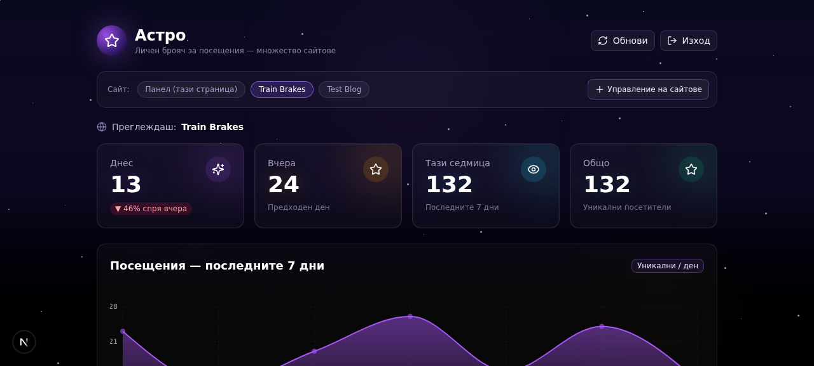

# Астро — Личен брояч за посещения

Личен брояч за посещения с поддръжка на **множество сайтове**. Вгради малък JS snippet във всеки свой сайт и виж статистики (Днес, Вчера, седмица, графики, топ държави и реферали) в един частен dashboard, защитен с PIN.

## 📸 Преглед

### Заключен екран (публичен изглед)


### Dashboard с множество сайтове


### Статистика за конкретен сайт


---

## ✨ Възможности

- 🔒 **PIN-защитен dashboard** — само ти виждаш статистиките (HttpOnly cookie + 7-дневна сесия)
- 🌐 **Множество сайтове** — регистрирай неограничен брой сайтове, за всеки отделна статистика
- 📊 **Богата статистика** — Днес, Вчера, Седмица, Общо + 7-дневна area-chart + топ държави + топ реферали
- 🎯 **Уникални посетители/ден** — дедупликирани по IP + User-Agent + Country хеш
- 📋 **Copy-paste snippet** — за всеки сайт се генерира JS snippet с `mode: "no-cors"`, работи на всяка платформа
- 🔄 **Ротиране на API ключове** — ако ключ утече, с един клик го смениш
- 📈 **Trend проценти** — автоматично смята ръст/спад спрямо вчера
- 🌌 **Космическа тема** — лилаво-черно background с мигащи звезди
- 🐳 **Docker-ready** — multi-stage build, non-root user, persistent volume

---

## 🚀 Бърз старт

### Изисквания

- Docker 20+ и Docker Compose v2
- Порт 3000 свободен (или промени в `docker-compose.yml`)

### Стъпка 1 — Клонирай репото

```bash
git clone git@github.com:fedya-dev/astro-counter.git
cd astro-counter
```

> Ако нямаш SSH ключове, ползвай HTTPS:
> ```bash
> git clone https://github.com/fedya-dev/astro-counter.git
> cd astro-counter
> ```

### Стъпка 2 — Смени PIN-а! (ВАЖНО)

Не го оставяй `1234` — всеки, който знае това число, ще може да види статистиките ти.

```bash
nano docker-compose.yml
```

Намери реда и го смени:
```yaml
ADMIN_PIN: "1234"      # ← смени това
# на:
ADMIN_PIN: "твоя-таен-PIN-тук"
```

Запаметете (Ctrl+O, Enter) и излезте (Ctrl+X).

### Стъпка 3 — Билдни и пусни

```bash
docker compose up -d --build
```

Първоначалният билд отнема 1-2 минути.

### Стъпка 4 — Провери че тръгна

```bash
docker compose logs -f astro
# Ctrl+C за изход от лога (контейнерът продължава да работи)
```

Трябва да видиш:
```
[entrypoint] Applying Prisma schema to database...
✓ Ready in 87ms
```

### Стъпка 5 — Отвори в браузъра

```
http://ТВОЯ-СЪРВЪР-IP:3000
```

- Кликни **"Отключи детайлите"**
- Въведи PIN-а (този който си сложил в стъпка 2)
- Виждаш dashboard-а с празни статистики

### Стъпка 6 — Провери версията (за debug)

```bash
curl http://ТВОЯ-СЪРВЪР-IP:3000/api/version
# Трябва да върне: {"ok":true,"version":"v1.0.6",...}
```

Ако не виждаш `v1.0.6` — ребилдни без кеш:
```bash
docker compose down
docker compose build --no-cache
docker compose up -d
```

---

## ⚙️ Конфигурация (environment variables)

В `docker-compose.yml` под `environment:`:

| Променлива | Задължителна | Default | Описание |
|-----------|--------------|---------|----------|
| `ADMIN_PIN` | **ДА** ✓ | `1234` | PIN за отключване на dashboard-а. **Смени го!** |
| `DATABASE_URL` | Не | `file:/app/data/custom.db` | Път до SQLite файла (volume mount) |
| `TZ` | Не | `Europe/Sofia` | Timezone за дневни граници (днес/вчера) |
| `NEXT_PUBLIC_BASE_URL` | Не | (auto-detected) | Публичен URL за snippet-а. Ако е празно, се детектира от request headers (работи зад reverse proxy) |

---

## 🌐 Добавяне на сайт

1. Отвори `http://твоя-сървър:3000` → отключи с PIN
2. Кликни **"Управление на сайтове"** (горе-дясно)
3. Във формата:
   - **Име на сайта** (напр. "Train Brakes")
   - **Домейн** (напр. "trainbrakes.com")
4. Клик **"Добави сайт"**
5. В списъка със сайтове кликни **"Код"** до него
6. Кликни **"Копирай"** — snippet-ът е в клипборда
7. Постави snippet-а в HTML-а на сайта си, **точно преди `</body>`**

### За различни платформи:

| Платформа | Къде да сложиш snippet-а |
|-----------|--------------------------|
| **Astro** | `src/layouts/Layout.astro` преди `</body>` — **ползвай `<script is:inline>`**, иначе Astro ще минифицира/промени кода и ще счупи tracking-а |
| **WordPress** | Appearance → Theme Editor → `footer.php` преди `</body>` (или плъгин "Insert Headers and Footers") |
| **Чист HTML** | Във всеки `.html` файл, преди `</body>` |
| **Next.js** | В root layout `app/layout.tsx` или `pages/_app.tsx` |
| **Shopify** | Online Store → Themes → Edit code → `theme.liquid` преди `</body>` |
| **Wix** | Settings → Custom Code → + New Custom Code → "Body - end" |

### ⚠️ Специално за Astro (важно!)

Astro по подразбиране processing-ва `<script>` таговете — bundl-ва ги, минифицира ги, понякога ги премахва. Това ще счупи tracking snippet-а.

Затова **винаги** добавяй `is:inline` директива:

```astro
---
// твоят frontmatter
---

<!DOCTYPE html>
<html lang="bg">
  <head>...</head>
  <body>
    <slot />
    
    <!-- ВАЖНО: is:inline казва на Astro да НЕ пипа този script -->
    <script is:inline>
      // ...кодът от dashboard-а тук...
    </script>
  </body>
</html>
```

Без `is:inline` — snippet-ът **няма** да работи след билд.

---

## 🔐 Безопасност

### Как работи

- **API ключът** в snippet-а (`k=sk_...`) е "видим" в source code-а на сайта ти — това е **по дизайн**. Най-лошото, което някой може да направи с него, е да "напълни" статистиките ти с фалшиви посещения.
- **Не може да чете данните ти** — статистиките са зад PIN cookie.
- Ако ключ утече / се злоупотреби → **"Генерирай нов API ключ"** в site manager → старият snippet спира да работи веднага → заместваш го с новия.

### Препоръки

1. **Смени PIN-а** от `1234` на нещо лично (поне 6 цифри)
2. **Сложи dashboard-а зад HTTPS** — виж по-долу
3. **Прави backup** на SQLite файла:
   ```bash
   docker compose exec astro cp /app/data/custom.db /backups/custom-$(date +%Y%m%d).db
   ```

---

## 🌍 HTTPS / Reverse Proxy (ПРОДУКЦИЯ)

**Важно!** Ако сайтът ти е на HTTPS (напр. `https://trainbrakes.com`), а dashboard-ът е на HTTP — браузърите ще блокират POST заявките (mixed content). Затова сложи dashboard-а зад HTTPS.

### Опция A: Cloudflare Tunnel (НАЙ-ЛЕСНО + БЕЗПЛАТНО)

Ако домейнът ти е в Cloudflare:

1. Cloudflare Zero Trust dashboard → Tunnels → твоя тунел → **Public Hostname** → Add
2. Subdomain: `astro`, Domain: `твоя-домейн.com`
3. Service: `http://localhost:3000` (или `http://сървър-LAN-IP:3000`)
4. **Path полето ОСТАВИ ПРАЗНО** (важно!)
5. Service URL: без trailing slash накрая (напр. `http://10.0.0.5:3000`, не `http://10.0.0.5:3000/`)
6. Клик **"Add route"** — DNS-ът и сертификатът се създават автоматично

### Опция B: Caddy (Let's Encrypt автоматично)

```bash
apt install caddy
echo 'astro.твоя-домейн.com {
    reverse_proxy localhost:3000
}' >> /etc/caddy/Caddyfile
systemctl restart caddy
```

### Опция C: Nginx + certbot

Класическият начин. Конфигурирай Nginx като reverse proxy + пусни `certbot --nginx`.

### След като сложиш dashboard-а на HTTPS

Влез в dashboard-а → **"Управление на сайтове"** → за всеки сайт кликни **"Код"** → копирай **новия** snippet (URL-ът ще е вече `https://...`) → заместваш в сайтовете си.

---

## 🐛 Трабълшутинг

### "Въвеждам PIN, изписва 'Достъп разрешен', но страницата не сменя"

**Причина 1:** Cookie-то има `Secure` флаг, но достъпваш през HTTP.

**Диагностика:**
```bash
# 1. Провери версията (трябва да е v1.0.6+)
curl http://твоя-сървър:3000/api/version

# 2. Тествай cookie-то с curl
curl -v -X POST http://твоя-сървър:3000/api/auth \
  -H "Content-Type: application/json" \
  -d '{"pin":"ТВОЯ-PIN"}' \
  -c /tmp/cookies.txt 2>&1 | grep -iE "set-cookie|http/"
```

Ако видиш `Secure` в Set-Cookie header-а при HTTP request → имаш стар код, ребилдни:
```bash
docker compose down
docker compose build --no-cache
docker compose up -d
```

**Причина 2:** Влизаш с грешен PIN. Провери какъв е реалният PIN в контейнера:
```bash
docker compose exec astro printenv ADMIN_PIN
```

### "Влизам с верен PIN, но връща 401"

PIN-ът в `docker-compose.yml` не съвпада с този, който въвеждаш.

```bash
# Виж какъв е реалният PIN в контейнера
docker compose exec astro printenv ADMIN_PIN
```

### "Site selector не показва данни за сайт"

1. Увери се, че си кликнал бутона на сайта (highlight-нат в лилаво)
2. Клик **"Обнови"** (горе-дясно)
3. Ако snippet-ът не е инсталиран на сайта — нямаш посещения още

### "Нова версия на кода не се обновява"

Docker е кеширал стар image.

```bash
docker compose down
docker compose build --no-cache
docker compose up -d
```

### "Cloudflare Tunnel: Bad Configuration: invalid address"

**Причина:** Имаш trailing slash в Service URL или path в Path полето.

**Решение:**
- Service URL: `http://10.0.0.5:3000` (БЕЗ `/` накрая)
- Path: остави празно

### "Caddy: DNS problem: NXDOMAIN"

**Причина:** Няма A запис за subdomain-а в DNS.

**Решение:** Добави A запис (или CNAME ако ползваш Cloudflare Tunnel).

---

## 💾 Backup & Restore

### Backup на SQLite DB

```bash
# Еднократно
docker compose exec astro cp /app/data/custom.db /tmp/backup-$(date +%Y%m%d).db
docker cp astro-counter:/tmp/backup-$(date +%Y%m%d).db ~/backups/

# Cron (всеки ден в 3:00)
echo "0 3 * * * docker compose -f /path/to/astro-counter/docker-compose.yml exec -T astro cp /app/data/custom.db /backups/astro-\$(date +\%Y\%m\%d).db" | crontab -
```

### Restore

```bash
docker compose down
cp ~/backups/astro-20260101.db ./data/custom.db
docker compose up -d
```

---

## 🔄 Обновяване на кода

След като си клонирал репото, за да вземеш нови промени:

```bash
cd astro-counter
git pull
docker compose up -d --build
```

---

## 🏗️ Технологии

- **Frontend:** Next.js 16 (App Router, standalone build), TypeScript, Tailwind CSS 4, shadcn/ui, Recharts, Framer Motion
- **Backend:** Next.js Route Handlers (API routes)
- **Database:** Prisma ORM + SQLite (file-based, persistent volume)
- **Auth:** PIN + HttpOnly session cookie (7 дни)
- **Tracking:** FNV-1a хеш за дедупликиране, CORS-open `/api/track` endpoint

---

## 📁 Структура на проекта

```
astro-counter/
├── prisma/
│   └── schema.prisma          # Site + Visit модели
├── src/
│   ├── app/
│   │   ├── api/
│   │   │   ├── auth/           # POST /api/auth (PIN login)
│   │   │   ├── track/          # POST/GET /api/track?site=X&k=Y (CORS-open)
│   │   │   ├── stats/          # GET /api/stats?site=X (admin-only)
│   │   │   ├── sites/          # GET/POST /api/sites + /api/sites/[id] + regenerate-key
│   │   │   ├── logout/         # POST /api/logout
│   │   │   ├── version/        # GET /api/version (за диагностика)
│   │   │   └── debug/auth-info # GET /api/debug/auth-info (за debug)
│   │   ├── layout.tsx          # Root layout (бг metadata)
│   │   ├── page.tsx            # Главна страница (рендира VisitorCounter)
│   │   └── globals.css
│   ├── components/
│   │   ├── visitor-counter.tsx # Главен клиентски компонент (locked/dashboard/site manager)
│   │   └── ui/                 # shadcn/ui компоненти
│   └── lib/
│       ├── db.ts               # Prisma client singleton (с invalidate при schema промяна)
│       ├── visitor-utils.ts    # getVisitorHash, isHttpsRequest, buildTrackingSnippet, etc.
│       └── version.ts          # APP_VERSION
├── docs/                      # Скрийншоти за README
├── Dockerfile                 # Multi-stage build (deps → build → runtime)
├── docker-compose.yml         # One-command deploy
├── docker-entrypoint.sh       # Auto prisma db push + node server.js
├── .dockerignore
└── .env.docker.example        # Документация на env vars
```

---

## 🗺️ Roadmap / Идеи за бъдеще

- [ ] CSV експорт на посещения
- [ ] Email репорт дневно
- [ ] Webhook при броене на milestone (100, 1000, etc.)
- [ ] Multi-user поддръжка (различни PIN-ове за различни sites)
- [ ] Real-time websocket обновяване
- [ ] Customizable dashboards per site
- [ ] Geo-IP с градове (не само държави)

---

## 📝 Лиценз

Личен проект. Използвай свободно.

---

## 🆘 Проблеми?

Провери:
1. `docker compose logs astro` — гледай лога
2. `curl http://твоя-сървър:3000/api/version` — потвърди версията
3. `curl http://твоя-сървър:3000/api/debug/auth-info` — виж HTTPS детекцията

---

**Версия:** v1.0.6 · Изграден на 2026-10-21
